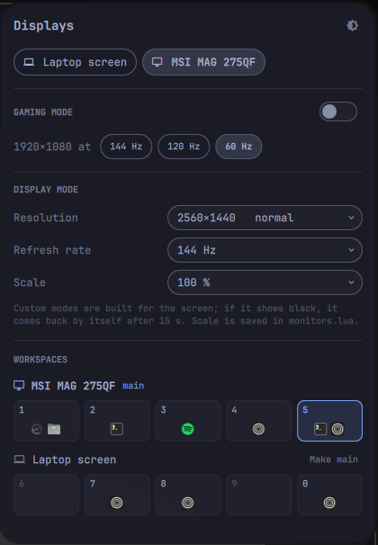

# Displays

A small Omarchy shell plugin for a laptop that often has a second screen.



- **Workspaces follow the main screen.** The main screen gets workspaces 1–5 and
  the other one 6–10. Unless you pick one, the main screen is the external
  screen, so plugging one in moves 1–5 onto it; unplugging brings everything
  back to the laptop.
- **Resolution, refresh rate and scale dropdowns**, applied as soon as you
  pick. Besides the modes the screen reports, the common resolutions and rates
  it can plausibly drive are listed as *custom* (no bigger, faster or heavier
  on the link than what it already shows). Hyprland builds those on the fly;
  if the screen refuses one, it is dropped at once, and if it is not kept it
  goes back by itself after 15 s, black screen or not. A custom mode lasts
  until *Back to normal* or the end of the session; the bar glyph is a gamepad
  meanwhile. Scale only offers values Hyprland accepts for the resolution and
  is saved on the screen's line in `monitors.lua`.
- **A tile per workspace** in the panel, grouped by screen, with the icons of the
  apps open on it; click one to go there.
- **Workspaces per screen on the bar**, with the companion widget
  `displays-workspaces`: each bar shows only its own screen's workspaces
  (1–5 on the main one, 6–0 on the other) behind a laptop or monitor glyph,
  each number followed by the icons of its apps.

- **Screens on and off** from their row in the panel; the last screen that is
  on cannot be turned off. It stays off across Hyprland reloads, until you turn
  it back on or the session ends.

With this, Omarchy's own *Display* widget can come off the bar
(`omarchy plugin disable omarchy.monitor`); brightness stays on the keyboard
keys.

## Install

```bash
omarchy plugin add https://github.com/loneycoffee/omarchy-displays.git --enable
omarchy restart shell
```

The plugin installs its companion widget next to itself
(`~/.config/omarchy/plugins/displays-workspaces`) and keeps it up to date. Put it
on the bar in place of Omarchy's workspaces widget:

```bash
omarchy bar put displays-workspaces --after omarchy.menu
```

and take `omarchy.workspaces` off the bar (edit `~/.config/omarchy/shell.json`).

Then make Hyprland load the generated rules, at the end of
`~/.config/hypr/hyprland.lua` or a file it requires:

```lua
local displays_lua = (os.getenv("XDG_RUNTIME_DIR") or "") .. "/omarchy-displays/hyprland.lua"
local displays_file = io.open(displays_lua, "r")
if displays_file then
  displays_file:close()
  dofile(displays_lua)
end
```

In `~/.config/hypr/monitors.lua`, remove any `hl.workspace_rule` lines (the
plugin owns them) and give the screens to the right of the first one
`position = "auto-right"`, so a screen that changes size or scale never
overlaps its neighbour.

To open the panel with the key Omarchy uses for its Display panel, add to
`~/.config/hypr/bindings.lua`:

```lua
hl.unbind("SUPER + CTRL + D")
o.bind("SUPER + CTRL + D", "Displays", "omarchy-shell shell toggle displays")
```

Update with `omarchy plugin update displays`.

## Command line

Everything goes through `bin/displays-ctl`, which the panel and the service call:

```
displays-ctl state                   JSON for the bar panel
displays-ctl apply                   rewrite the Hyprland rules, move workspaces
displays-ctl mode NAME WxH@HZ        e.g. displays-ctl mode HDMI-A-1 1920x1080@119.88
displays-ctl scale NAME SCALE        e.g. 1.25, saved in monitors.lua
displays-ctl keep|undo NAME          keep or drop a custom mode being tried
displays-ctl normal NAME             back to the mode from monitors.lua
displays-ctl primary NAME|auto       which screen gets workspaces 1-5
displays-ctl power NAME on|off       turn a screen on or off (never the last one)
displays-ctl sync-companion          install or refresh the workspaces bar widget
```

Open the panel from a keybinding with `omarchy-shell shell toggle displays`.

## How it works

`displays-ctl` writes `$XDG_RUNTIME_DIR/omarchy-displays/hyprland.lua` (monitor
overrides and workspace rules) and reloads Hyprland only when that file changes,
then moves existing workspaces to their screen. The service runs it when the
shell starts and on every `monitoradded` / `monitorremoved` event. The runtime
directory is emptied at logout, so each session starts from `monitors.lua`.

## License

MIT
